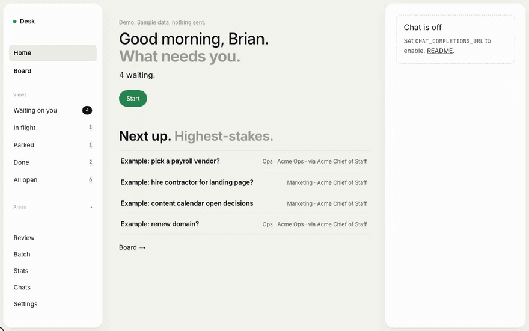
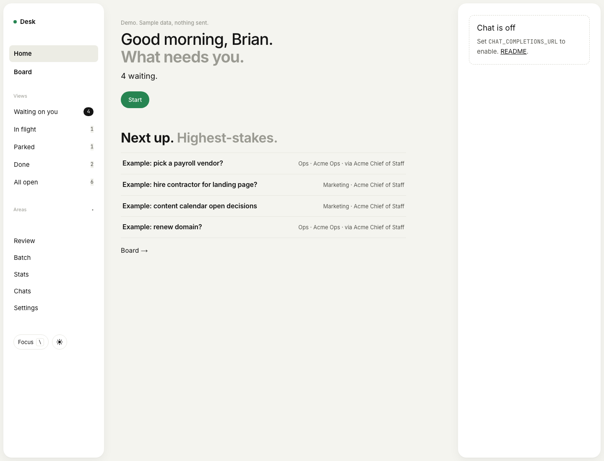

# Decision Desk

A self-hosted desk for one operator. Agents raise decisions; you open one page per item, read the **verdict first**, and press **Approve**, **Decline**, or **Discuss**. Tasks live on a source-agnostic Board. Inspired by Brian Armstrong's chief-of-staff agent model.

This is a kit you run yourself. It is not a hosted product.



Sample screenshot (fake Acme data only):



## Try the static demo

The demo is **browser-only**. It uses a `localStorage` TaskStore seeded with obviously fake Acme sample data. Sign-in, chat, webhooks, and the agent API are off.

```bash
git clone https://github.com/DevMandalia/decision-desk.git
cd decision-desk
npm install
npm run demo
```

That builds a static export (`DESK_DEMO=1` / `NEXT_PUBLIC_DESK_DEMO=1`) and serves `out/` at [http://127.0.0.1:4173](http://127.0.0.1:4173).

To point a GitHub Pages project site at a sub-path:

```bash
NEXT_PUBLIC_BASE_PATH=/decision-desk npm run build:demo
npx serve out
```

A GitHub Actions workflow (`.github/workflows/pages.yml`) can publish that export. It is **`workflow_dispatch` only** — nothing deploys until you run it.

## 60-second local start (live desk)

Needs Node 22+.

```bash
cp .env.example .env
# set OWNER_EMAIL and AUTH_SECRET; AUTH_DEV_BYPASS=1 skips Google for local use
npm install
npm run dev
```

Open [http://127.0.0.1:3000](http://127.0.0.1:3000). SQLite is the default store (`data/desk.sqlite`) and is seeded with the same fake Acme rows so you can click around immediately.

## Deploy on Vercel (no terminal)

[](https://vercel.com/new/clone?repository-url=https://github.com/DevMandalia/decision-desk&env=OWNER_EMAIL,AUTH_SECRET,AUTH_URL,AUTH_GOOGLE_ID,AUTH_GOOGLE_SECRET&envDescription=Owner%20allowlist%20and%20Auth.js%20secrets.%20Do%20not%20set%20AUTH_DEV_BYPASS.&project-name=decision-desk&repository-name=decision-desk)

On Vercel the kit falls back to the in-memory store unless you set `DATABASE_URL` (Postgres) or point `DECISION_SOURCE` / `TASK_STORE` at Notion. `AUTH_DEV_BYPASS` is ignored in production and on Vercel.

## What you get

- One page per decision, verdict first, Approve / Decline / Discuss
- Discuss opens a reply thread (owner and agent take turns) until Approve or Decline
- Board of tasks with configurable column names
- Home, Waiting, In flight, Parked, Done
- Dark mode, Prev / Next, keyboard shortcuts
- Owner-only Auth.js sign-in (`OWNER_EMAIL` allowlist)
- Agent HTTP API with hashed per-agent keys (`ddk_…`)
- Optional per-agent HMAC webhooks (`X-Desk-Signature`) plus polling `get_verdict`
- MCP `.mcpb` stdio client over that REST API

## Connect your decision / task source

The board and the desk talk only to TypeScript interfaces:

- `DecisionSource` — `src/lib/types.ts`
- `TaskStore` — `src/lib/tasks/types.ts`

Pick adapters with env vars. **Nothing in `src/lib`, `src/app`, or `src/components` imports `@notionhq/client`.**

| Variable | Values | Default |
| --- | --- | --- |
| `DECISION_SOURCE` | `sqlite` \| `memory` \| `postgres` \| `notion` | `sqlite` locally, `memory` on Vercel / `DESK_DEMO` |
| `TASK_STORE` | same | same |
| `DESK_LEDGER` | `sqlite` \| `memory` \| `postgres` | same as above (agents + API keys) |
| `BOARD_COLUMNS` | comma-separated labels | one column per status the store reports |
| `DATABASE_URL` | Postgres URL | unset |
| `OWNER_EMAIL` | allowlisted owner | required for live sign-in |
| `AUTH_PROVIDER` | `google` \| `github` | `google` |
| `DESK_TIMEZONE` | IANA zone | `America/Los_Angeles` |
| `DESK_DEMO` / `NEXT_PUBLIC_DESK_DEMO` | `1` | unset |
| `NEXT_PUBLIC_BASE_PATH` | e.g. `/decision-desk` | empty (site root) |

Notion is an **optional example** adapter (`adapters/notion`). See `adapters/notion/README.md`.

## Agent API

Create a key in **Settings**. The plaintext `ddk_…` value is shown once and stored hashed. The key is the agent's identity. A lead can register a sub-agent (`POST /api/v1/agents`); every decision and task records `raised_by` (and optional parent). Board cards and Waiting show that tag.

```bash
# raise_decision
curl -sS -X POST "$DESK/api/v1/decisions" \
  -H "Authorization: Bearer $DESK_TOKEN" \
  -H "Content-Type: application/json" \
  -d '{"title":"Renew the staging cert?","decision_needed":"Buy another year?"}'

# add_task
curl -sS -X POST "$DESK/api/v1/tasks" \
  -H "Authorization: Bearer $DESK_TOKEN" \
  -H "Content-Type: application/json" \
  -d '{"title":"Draft the renewal invoice"}'

# list_items
curl -sS "$DESK/api/v1/items" -H "Authorization: Bearer $DESK_TOKEN"

# get_verdict (poll)
curl -sS "$DESK/api/v1/decisions/$ID/verdict" -H "Authorization: Bearer $DESK_TOKEN"

# reply_discussion
curl -sS -X POST "$DESK/api/v1/decisions/$ID/replies" \
  -H "Authorization: Bearer $DESK_TOKEN" \
  -H "Content-Type: application/json" \
  -d '{"message":"Cost is $14. Recommend yes."}'
```

There is **no shared desk webhook**. Optional per-agent HMAC webhooks fire on Approve / Decline (`X-Desk-Signature: sha256=…`). Optional owner email / Slack alerts are separate.

MCP: `dist/decision-desk.mcpb` (stdio). User config is desk URL + agent token. Tools: `raise_decision`, `add_task`, `list_items`, `get_verdict`, `reply_discussion`. Pack with `npm run mcp:pack`. Verify locally with `npm run mcp:test`.

## Roadmap

Not in this release:

- **Background refresh** of the Board / desk from the store while a page is open
- **Edit-conflict warnings** when a card changed under you
- **Custom live activity bar** for Decision Desk, built from scratch for desk flows (agent-raised decisions, verdicts, agent working, Approve/Decline preview), inspired by islandcn's motion concepts.

## License

MIT. See [LICENSE](LICENSE).
